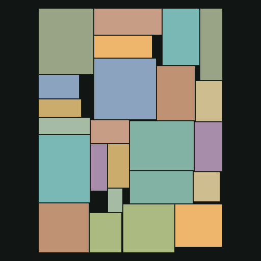

# Revo 2

A reusable CUDA-first cellular evolution engine with two visual demos: image-generating programs and rectangle packing. Rust runs experiments and the local playground; CUDA keeps initialization, selection, variation, evaluation, replacement, and statistics on the GPU.

## Run the playground

With stable Rust, a native linker, an NVIDIA driver, and CUDA 12.x NVRTC available:

```powershell
cargo run --release
```

Open **http://127.0.0.1:8787**, choose **Image programs** or **Rectangle packing**, apply settings, then run evolution. The initial population is paused. Click a population cell or use arrow keys to inspect competing solutions.

Set **Population X** and **Population Y** independently to any integers from 1 to 256. The heatmap keeps the grid's rectangular proportions; one-row, one-column, and single-cell populations also work.

```powershell
# Start directly in packing mode
cargo run --release -- --problem packing

# Explicit CPU reference; no silent fallback from CUDA
cargo run --release -- --backend cpu

# Remove the CUDA dependency entirely
cargo run --release --no-default-features -- --backend cpu
```

On Windows, `scripts/dev.ps1` launches the app and supports optional project-local tools under ignored `.tools/`. To use those tools in a shell, dot-source `. .\scripts\env.ps1`, then run Cargo normally. Install Visual Studio C++ Build Tools and a Windows SDK for the native linker. NVRTC is loaded at runtime, with kernels compiled at experiment setup; neither `nvcc` nor a CUDA toolkit is needed at Rust build time. CUDA 12.8 is the tested runtime. Add its library directory to `PATH` on Windows or `LD_LIBRARY_PATH` on Linux. Only Windows with an RTX 4070 Laptop GPU has been exercised so far.

The server binds to loopback, uses only local assets, and sends no experiment data to a cloud service. Ctrl+C stops it.

## Reusable core

`crates/revo-core` is a standalone library with **no image, packing, web-server, or rendering dependencies**. The root package contains the demos and application adapters.

```toml
[dependencies]
revo-core = { path = "path/to/revo2/crates/revo-core" }
```

Implement the `Problem` trait to supply initialization, recombination, mutation, scoring, and optional CUDA callbacks. The core uses fixed-length `u32` buffers as a storage ABI, with no prescribed interpretation. It handles the same synchronous toroidal population, local tournaments, preallocated double buffers, RNG streams, elitist replacement, and statistics for every problem. Scores are minimized. Negative values are supported; nonfinite values receive a worst-score penalty.

See **[the problem-interface guide](docs/problems.md)** for the full CPU/CUDA contract, safety requirements, and examples. The [standalone sphere test](crates/revo-core/tests/problem.rs) implements another problem outside the engine. Adding a problem does not require changes to the engine's kernels or a problem-type switch in the library.

## Rectangle packing

Pack every rectangle, with optional 90° rotation, to minimize the **area of the actual enclosing rectangle**. Shapes keep their dimensions, and decoded layouts never overlap. The display shows bounding area, fill ratio, dimensions, placement order, population fitness, and SVG/JSON/image exports.

A genome contains a permutation, rotation flags indexed by rectangle ID, and a placement-width gene. Order-preserving crossover and swap/rotation/width mutations preserve valid permutations. A deterministic skyline decoder considers x=0 and previous right edges, placing each piece at the lowest skyline height that fits, with leftmost tie-breaking. The fitness is `1 − total_rectangle_area / bounding_area`, so a perfect tiling has score zero. With a fixed rectangle set this is equivalent to minimizing bounding area. The sum of rectangle areas is a lower bound, not a proof that a layout is optimal.

This is **heuristic packing**, not an exact solver. The skyline decoder restricts reachable layouts and does not fill arbitrary cavities. Width is evolved rather than fixed. It ranges from the longest piece side to the sum of longest sides; the lower limit removes a global-rotation symmetry without preventing pieces from fitting in either orientation. Search can converge prematurely; maintaining diverse populations is a useful next experiment.

Presets are Mixed rectangles, Modular tiles, and Long rectangles. The rectangle-set seed is separate from the evolution seed so algorithm comparisons can keep the same pieces. Each population cell is a complete layout.

```powershell
cargo run --release -- --problem packing run --generations 1000 --output runs/packing
cargo run --release -- run --config examples/packing.json --generations 2000 --output runs/packing-config
cargo run --release -- run --rectangles examples/rectangles.json --generations 1000 --output runs/custom-packing
```

Custom rectangle files are JSON arrays of `{ "width": 60, "height": 40 }` objects. The first implementation supports 1–64 custom rectangles with integer dimensions 1–512; generated presets use 2–64 pieces. Exports include `solution.json` (rectangles, genome, decoded layout), `rectangles.json`, `best.png`, `layout.svg`, configuration, metadata, and fitness history.

A seeded trial with 1,024 cells and 24 mixed rectangles reached **95.6% fill** after 1,000 CUDA generations, reducing bounding area from 52,008 to 48,768; the area lower bound was 46,638. The evolution loop took approximately 0.50 seconds on the RTX 4070 Laptop GPU, excluding setup/JIT, rendering, and export. This is an exploratory single-run result, not a performance or optimality guarantee.



## Image programs

Each individual is a bounded acyclic graph implementing `(x,y) → (r,g,b)`. Inputs are x, y, radius, two sine waves, and 1. Operations include constants, arithmetic, protected division, sine/cosine, absolute value, min/max, tanh, and a threshold. Connections point backward; the final three nodes produce RGB. Intermediate values clamp to [-8,8] and RGB to [0,1]. The threshold uses a small dead band to reduce CPU/CUDA branch differences near equality.

Fitness is mean squared RGB error plus a small active-node penalty. The fixed training grid makes parent and offspring scores comparable. Separate validation MSE makes overfitting visible; a low-resolution training grid can miss artifacts between samples. Uploads are center-cropped to a square and transparency is composited over a dark background. This is a small-program approximation demo, not a photorealistic image model.

```powershell
cargo run --release -- run --preset rings --generations 10000 --output runs/rings
cargo run --release -- run --target path/to/image.png --population 64 --nodes 32 --seed 42 --output runs/custom-image
```

Image exports additionally include `target.png`, legacy `program.json`, and `program.glsl`. GLSL exports `vec3 revo(vec2 p)` for p in [-1,1]. The image demo owns its optional CUDA preview renderer; rendering is not an engine method. Packing previews use decoded host geometry. Both observe only selected genomes, not the whole population's geometry.

| Target | Evolved program |
| --- | --- |
|  |  |

## Experiments and exports

Use `--width X --height Y` for any rectangular grid (each dimension 1–256). For example, `cargo run --release -- --problem packing run --width 37 --height 13 --output runs/wide` creates 481 individuals. `--population N` remains a square-grid shortcut and conflicts with explicit width/height. JSON configurations also accept independent `width` and `height`. The original flat image configuration remains readable; new files include a `problem` field. `--config` conflicts with explicit population/width/height/node/seed/sample overrides. `--checkpoint` controls observation frequency, not resumable population checkpointing.

Nonempty output directories are rejected. `run.json` contains backend, settings, metrics, and timings; `history.csv` contains best/mean minimized scores. Image runs report a separate 128×128 unpenalized validation MSE. Packing runs report enclosing area and utilization. Reproduce runs with their `config.json` plus `target.png` or `rectangles.json`. Evolution timing includes progress observations but excludes setup, JIT, rendering, and exports. Floating-point differences can eventually change CPU/CUDA search trajectories.

```powershell
# Render either saved solution without initializing CUDA
cargo run --release -- render runs/packing/solution.json --output packing.png
cargo run --release -- render docs/examples/rings-program.json --size 1024 --output rings.png
```

The population heatmap uses the current generation's relative fitness. Uniform color indicates converged scores, not a solved problem. White marks the inspected cell. The logarithmic chart shows best and mean fitness, with old history decimated. Exports always use the best solution even while inspecting another cell.

## Checks

```powershell
cargo test --workspace
cargo test --workspace --no-default-features
cargo test --workspace -- --include-ignored
cargo clippy --workspace --all-targets -- -D warnings
cargo fmt --all -- --check
```

Ignored GPU tests require an NVIDIA driver and NVRTC. Tests compare CPU/CUDA initialization, fitness, image previews, and packing evolution; cover minimum/maximum encodings, negative/large/nonfinite fitness, deterministic streams, and independent geometry feasibility. Application tests check transactional resets and problem-specific uploads.

The core's common kernels are in `crates/revo-core/kernels`. Image and packing device callbacks live beside their implementations under `src/problems/`. `src/demo.rs` handles presentation/exports; `src/server.rs` owns the worker and HTTP interface; `web/` contains the playground.

Next experiments: diversity preservation, cellular/global selection comparisons, multi-resolution image scoring with incumbent re-evaluation, alternative packing decoders, and full-population save/resume.
